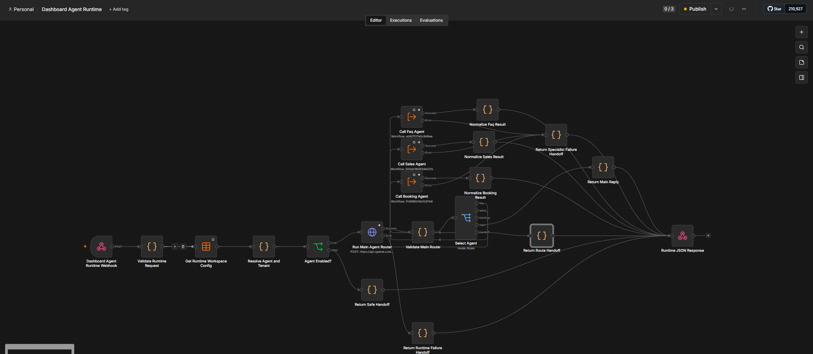
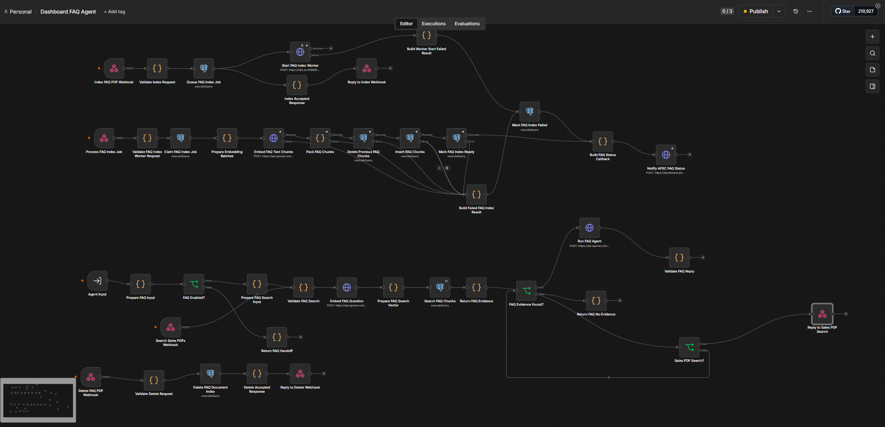
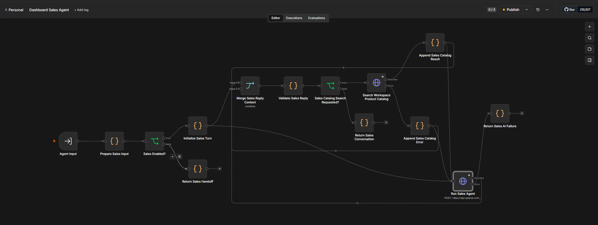
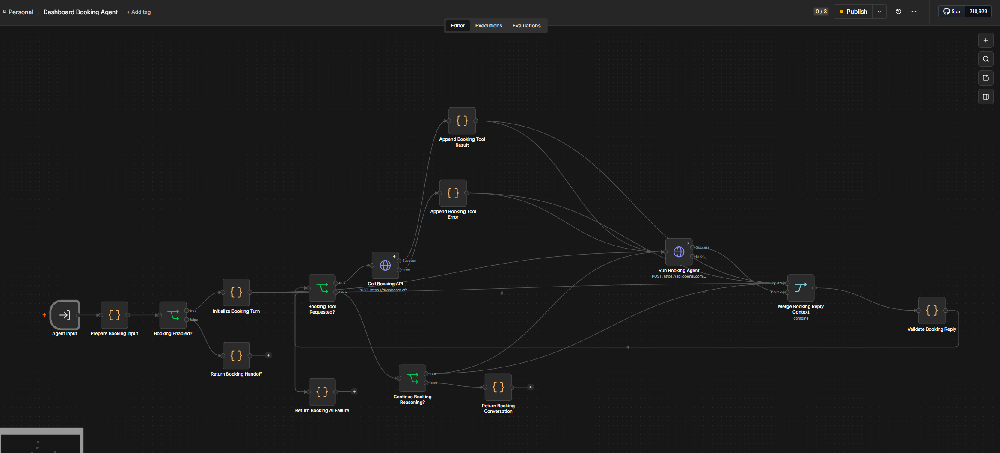
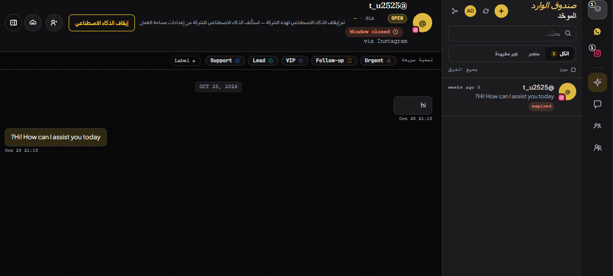
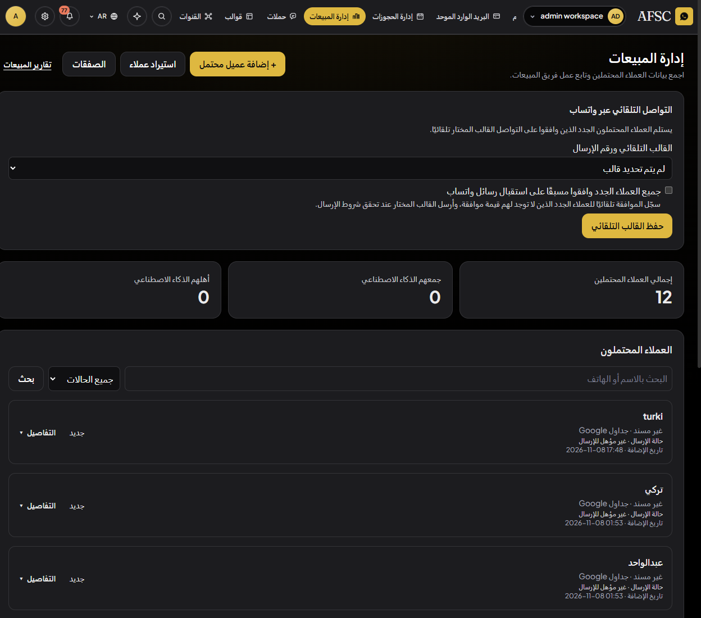

# Multi-Agent AI Automation Platform

### AI-powered customer support, sales, and booking automation using n8n, RAG, and API integrations.

## Overview

An AI-powered customer support solution designed to automate customer interactions through conversational AI, workflow orchestration, and knowledge-based response generation.

The project demonstrates how AI agents can be integrated with messaging platforms and business knowledge sources to provide relevant, context-aware customer support.

This repository serves as a technical showcase. The full implementation and private infrastructure are not publicly available.

## Technologies

- **n8n** — Workflow automation and orchestration
- **FastGPT** — AI agent and knowledge-base management
- **RAG** — Retrieval-Augmented Generation
- **WhatsApp Business API** — Customer messaging integration
- **REST APIs & Webhooks** — Communication between services

## Key Features

- Automated customer inquiry handling
- Knowledge-based AI responses
- Context-aware question answering using RAG
- Workflow orchestration through n8n
- Integration with messaging platforms
- Extensible architecture for business-specific AI agents

## System Architecture

The solution follows a modular architecture:

Customer Message → WhatsApp Integration → n8n Workflow → AI Agent / Knowledge Base → Generated Response → Customer

## Project Screenshots

## Project Screenshots

### Multi-Agent Orchestration

### FAQ Agent - RAG Workflow

### Sales AI Agent

### Booking AI Agent

### Customer Support Interface

### Sales Management Dashboard

## Privacy & Implementation

This repository is intended for portfolio and demonstration purposes.

The complete source code, internal configurations, API credentials, production workflows, and customer data are excluded to protect proprietary information.

## Project Focus

AI Engineering · Conversational AI · RAG · Workflow Automation · API Integration
